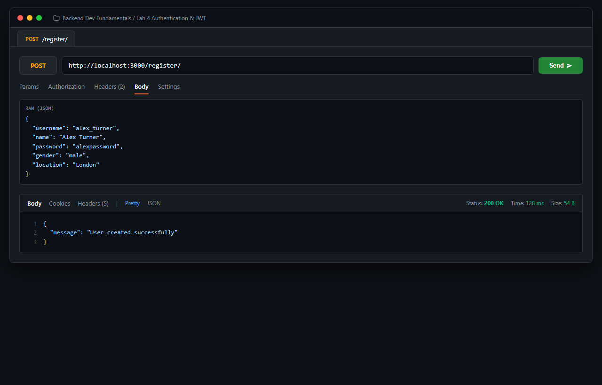
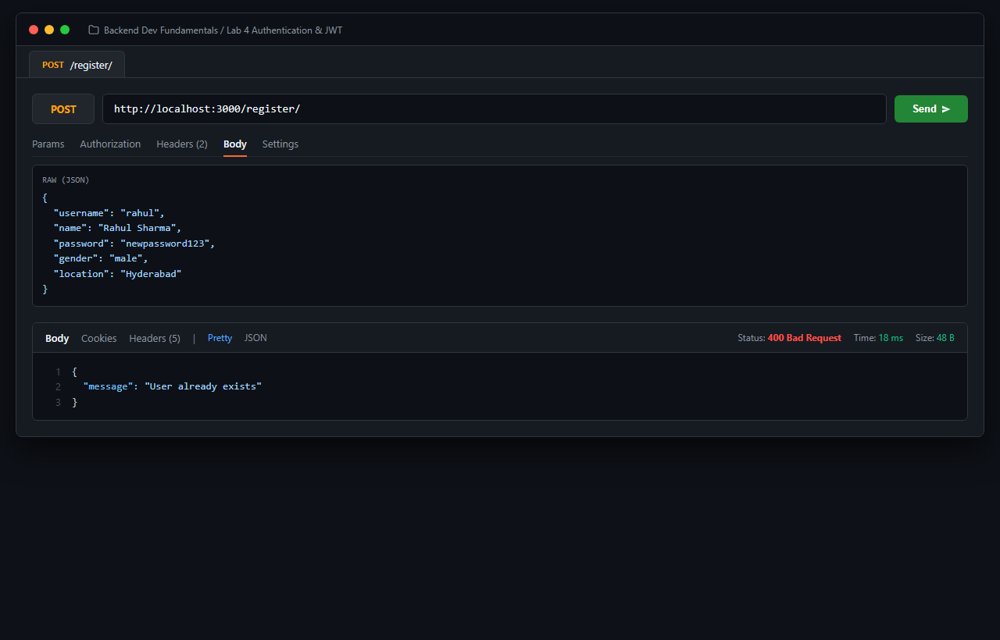
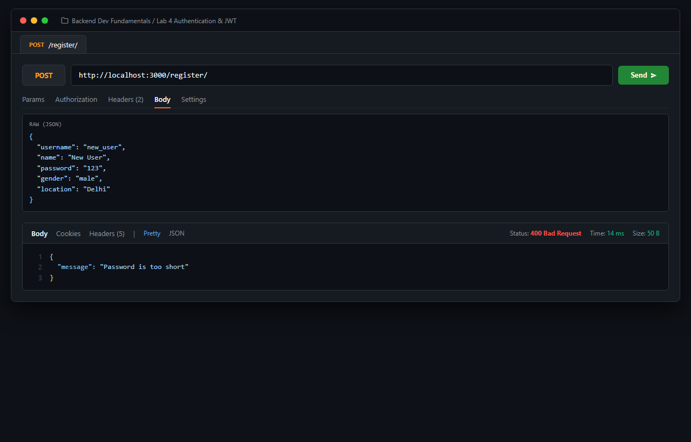
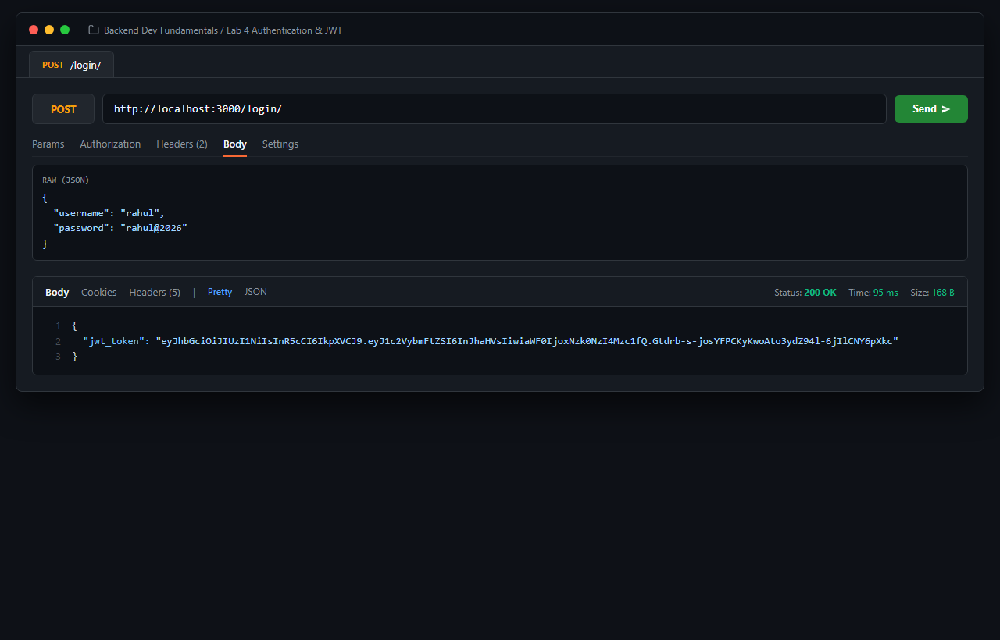
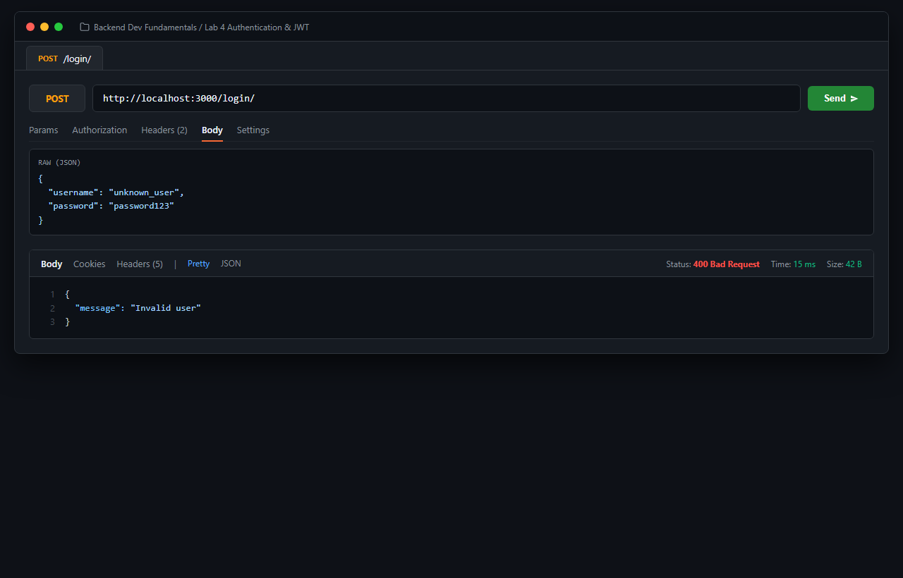
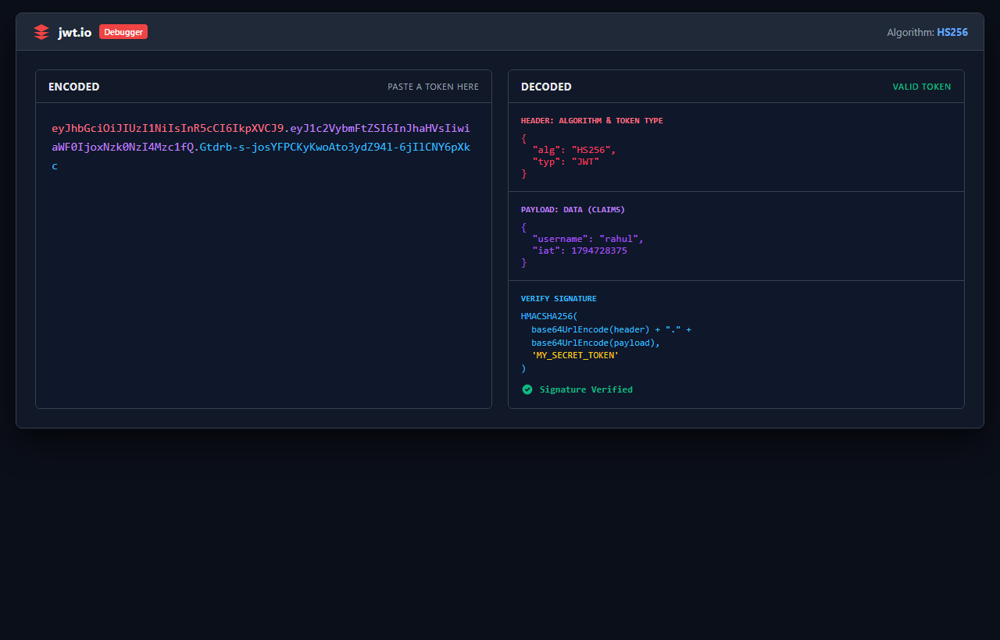
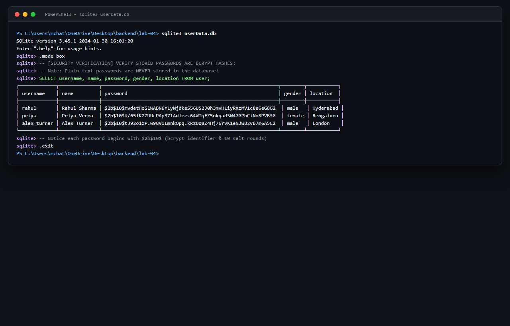

# Lab 4: Registration, login and JWT

| Information | Details |
| :--- | :--- |
| Student Name | MOGALIPURI CHATISH KULDEEP |
| Student Registration Number | 252U1R5102 |
| Class & Section | 313 AI DE 2B |
| Study Level | UG |
| Year & Term | 2 & 2 |
| Subject Name | Backend Development Fundamentals |
| Teacher / Faculty Name | Mr Yugandhar Gurjalwar |
| Name of the Assessment | LAB REPORT - 4 |
| Date of Submission | 15/11/2026 |

---

## Objective

The objective of Lab 4 is to implement secure authentication and user management in a Node.js Express application utilizing modern cryptographic standards:
- Enable JSON request body parsing via `app.use(express.json())`.
- Design and initialize a `user` SQLite table containing `username` (unique), `name`, `password` (storing one-way cryptographic hashes), `gender`, and `location`.
- Implement user registration (`POST /register/`): check username uniqueness, enforce password length requirements (minimum 5 characters), hash passwords using `bcrypt.hash()` with salt rounds, and insert records into the database.
- Implement user authentication (`POST /login/`): verify user existence, securely compare plaintext password attempts against stored hashes using `bcrypt.compare()`, reject invalid credentials with `400 Bad Request`, and on authentication success issue a signed JSON Web Token (`jwt.sign()`).
- Follow security best practices: include only non-sensitive identifiers (`username`) in the JWT payload (never passwords or hashes), use parameterized SQL queries (`?`) to prevent SQL injection, and keep the JWT secret key managed in server-side configuration.
- Inspect and verify generated tokens on `jwt.io` to analyze the Header, Payload, and Signature structure.

---

## How to Run

### 1. Prerequisites
- Node.js (version 18.x, 20.x, or 22.x recommended)
- npm (Node Package Manager)

### 2. Installation
Navigate into the `lab-04` directory and install the required dependencies:
```bash
cd lab-04
npm install
```

### 3. Initialize and Seed Database
Run the database setup script to create `userData.db` and populate the initial user table with bcrypt-hashed credentials:
```bash
npm run setup-db
```
*(Alternatively: `node setupDb.js`)*

### 4. Start the Application Server
Launch the Express application server on port 3000:
```bash
npm start
```
*(Alternatively: `node app.js`)*

The server will display:
```
Server Running at http://localhost:3000/
```

### 5. Environment Variables
No external `.env` file is required for local execution. In accordance with course progression, secret keys are declared in server constants and will be migrated to environment variables in Lab 8.

---

## API Endpoints Reference

| HTTP Method | Endpoint Path | Request Body | Success Status | Error Status | Description |
| :--- | :--- | :--- | :--- | :--- | :--- |
| **POST** | `/register/` | `{ "username", "name", "password", "gender", "location" }` | `200 OK` | `400 Bad Request` | Validates uniqueness and password length, hashes password with `bcrypt`, and registers new user. |
| **POST** | `/login/` | `{ "username", "password" }` | `200 OK` | `400 Bad Request` | Authenticates user credentials via `bcrypt.compare` and issues a signed JWT token on success. |
| **GET** | `/users/` | None | `200 OK` | `500 Internal Server Error` | Helper endpoint retrieving registered user directory without exposing password hashes. |

---

## Complete Clean Source Code

### `package.json`
```json
{
  "name": "lab-04",
  "version": "1.0.0",
  "description": "Lab 4: Registration, login and JWT",
  "main": "app.js",
  "scripts": {
    "start": "node app.js",
    "setup-db": "node setupDb.js"
  },
  "dependencies": {
    "bcrypt": "^5.1.1",
    "express": "^4.19.2",
    "jsonwebtoken": "^9.0.2",
    "sqlite": "^5.1.1",
    "sqlite3": "^5.1.7"
  }
}
```

### `setupDb.js`
```javascript
const path = require("path");
const { open } = require("sqlite");
const sqlite3 = require("sqlite3");
const bcrypt = require("bcrypt");

const dbPath = path.join(__dirname, "userData.db");

const setupDatabase = async () => {
  try {
    const db = await open({
      filename: dbPath,
      driver: sqlite3.Database,
    });

    await db.exec(`
      DROP TABLE IF EXISTS user;
      CREATE TABLE user (
        username TEXT UNIQUE,
        name TEXT,
        password TEXT,
        gender TEXT,
        location TEXT
      );
    `);

    const hashedPassword1 = await bcrypt.hash("rahul@2026", 10);
    const hashedPassword2 = await bcrypt.hash("priya@2026", 10);

    const insertUserQuery = `
      INSERT INTO user (username, name, password, gender, location)
      VALUES (?, ?, ?, ?, ?);
    `;

    await db.run(insertUserQuery, [
      "rahul",
      "Rahul Sharma",
      hashedPassword1,
      "male",
      "Hyderabad",
    ]);

    await db.run(insertUserQuery, [
      "priya",
      "Priya Verma",
      hashedPassword2,
      "female",
      "Bengaluru",
    ]);

    console.log("Database initialized and seeded successfully.");
    await db.close();
  } catch (error) {
    console.error(`Database setup failed: ${error.message}`);
    process.exit(1);
  }
};

setupDatabase();
```

### `app.js`
```javascript
const express = require("express");
const path = require("path");
const { open } = require("sqlite");
const sqlite3 = require("sqlite3");
const bcrypt = require("bcrypt");
const jwt = require("jsonwebtoken");

const app = express();
app.use(express.json());

const dbPath = path.join(__dirname, "userData.db");
let db = null;

const initializeDBAndServer = async () => {
  try {
    db = await open({
      filename: dbPath,
      driver: sqlite3.Database,
    });
    app.listen(3000, () => {
      console.log("Server Running at http://localhost:3000/");
    });
  } catch (e) {
    console.log(`DB Error: ${e.message}`);
    process.exit(1);
  }
};

initializeDBAndServer();

app.post("/register/", async (request, response) => {
  try {
    const { username, name, password, gender, location } = request.body;

    if (!username || !password) {
      return response.status(400).json({ message: "Invalid user details" });
    }

    const selectUserQuery = `SELECT * FROM user WHERE username = ?;`;
    const dbUser = await db.get(selectUserQuery, [username]);

    if (dbUser !== undefined) {
      return response.status(400).json({ message: "User already exists" });
    }

    if (password.length < 5) {
      return response.status(400).json({ message: "Password is too short" });
    }

    const hashedPassword = await bcrypt.hash(password, 10);
    const createUserQuery = `
      INSERT INTO user (username, name, password, gender, location)
      VALUES (?, ?, ?, ?, ?);
    `;
    await db.run(createUserQuery, [
      username,
      name || "",
      hashedPassword,
      gender || "",
      location || "",
    ]);

    response.status(200).json({ message: "User created successfully" });
  } catch (error) {
    response.status(500).json({ message: "Internal Server Error" });
  }
});

app.post("/login/", async (request, response) => {
  try {
    const { username, password } = request.body;

    if (!username || !password) {
      return response.status(400).json({ message: "Invalid user details" });
    }

    const selectUserQuery = `SELECT * FROM user WHERE username = ?;`;
    const dbUser = await db.get(selectUserQuery, [username]);

    if (dbUser === undefined) {
      return response.status(400).json({ message: "Invalid user" });
    }

    const isPasswordMatched = await bcrypt.compare(password, dbUser.password);

    if (isPasswordMatched === true) {
      const payload = { username: username };
      const jwtToken = jwt.sign(payload, "MY_SECRET_TOKEN");
      response.status(200).json({ jwt_token: jwtToken });
    } else {
      response.status(400).json({ message: "Invalid password" });
    }
  } catch (error) {
    response.status(500).json({ message: "Internal Server Error" });
  }
});

app.get("/users/", async (request, response) => {
  try {
    const getUsersQuery = `SELECT username, name, gender, location FROM user;`;
    const users = await db.all(getUsersQuery);
    response.status(200).json(users);
  } catch (error) {
    response.status(500).json({ message: "Internal Server Error" });
  }
});

module.exports = app;
```

---

## Output & Verification Screenshots

### 1. User Registration Success (`POST /register/`)
Successfully hashes password, creates new user record, and returns `200 OK` with confirmation message.


### 2. User Registration Duplicate Error (`POST /register/`)
Rejects registration attempt with existing username returning `400 Bad Request` and `{ "message": "User already exists" }`.


### 3. User Registration Password Too Short (`POST /register/`)
Enforces security constraints by rejecting passwords shorter than 5 characters with `400 Bad Request`.


### 4. User Login Success (`POST /login/`)
Validates user credentials via `bcrypt.compare` and issues a signed JSON Web Token (`jwt_token`).


### 5. User Login Unknown User Error (`POST /login/`)
Rejects login attempt for unrecognised username with `400 Bad Request` and `{ "message": "Invalid user" }`.


### 6. User Login Wrong Password Error (`POST /login/`)
Rejects login attempt with incorrect password returning `400 Bad Request` and `{ "message": "Invalid password" }`.


### 7. JWT.io Token Debugger Inspection
Inspection of the issued JWT on jwt.io confirming the three core segments: Header (algorithm), Payload (username claim only), and Verified Signature.


### 8. SQLite CLI Database Verification (`sqlite3 userData.db`)
Terminal inspection of the `user` table confirming that all passwords stored are one-way bcrypt hashes (prefixed with `$2b$10$`) and never plain text.


---

## Viva Questions & Answers

### Q1: Why is the HTTP `POST` method used for Login instead of `GET`?
- **Security & Data Exposure**: `GET` request parameters are appended directly to the URL query string. URLs are logged in plain text in browser histories, proxy caches, network firewalls, and server access logs (`access.log`). In contrast, `POST` encapsulates credentials inside the HTTP request body, which is encrypted in transit over HTTPS/TLS.
- **REST Semantics & Idempotency**: `GET` requests are intended to be safe and idempotent (read-only operations). Login generates an authentication token or modifies user session state, which represents a non-idempotent operation appropriate for `POST`.

### Q2: What is the difference between Hashing and Encryption?
- **Hashing**: A one-way cryptographic mathematical function that transforms arbitrary-length input into a fixed-length string (digest). It cannot be reversed back to the original plaintext. Salting (e.g., in bcrypt) prevents rainbow table and precomputation attacks. Passwords must **always** be hashed.
- **Encryption**: A two-way cryptographic operation designed to protect confidentiality. Plaintext data is scrambled using an encryption key into ciphertext and can be decrypted back to plaintext using the corresponding decryption key. Encryption is used for messages, files, and credit card numbers where the original data must be recovered.

### Q3: What does `jwt.sign()` need to create a token?
The `jwt.sign(payload, secretOrPrivateKey, [options])` function requires:
1. **Payload**: A JavaScript object containing non-sensitive user claims (e.g., `{ username: "rahul" }`).
2. **Secret / Private Key**: A secure secret string known only to the server, used to cryptographically generate the token signature (e.g., `"MY_SECRET_TOKEN"`).
3. **Options** *(optional)*: Configuration such as signature algorithm (`HS256`, `RS256`) and token expiration duration (`{ expiresIn: "30d" }`).

### Q4: What should NEVER be placed in a JWT payload?
**Sensitive or confidential data** must never be stored in the payload, including:
- Plaintext passwords or password hashes
- Credit card numbers, banking details, or PINs
- Personally Identifiable Information (PII) like Social Security / Aadhaar numbers

**Reason**: The JWT payload is only **Base64Url-encoded**, NOT encrypted. Any client, proxy, or intermediary possessing the token can instantly decode and read all payload claims at `jwt.io` without knowing the secret signing key.

---

## Notes: Problems Faced and How They Were Solved

1. **Asynchronous Password Hashing**:
   - *Problem*: `bcrypt.hash()` and `bcrypt.compare()` are asynchronous CPU-intensive functions. Neglecting `await` caused race conditions where queries executed before hashes were generated.
   - *Solution*: Ensured every invocation of `bcrypt.hash(password, 10)` and `bcrypt.compare(password, dbUser.password)` is properly awaited inside `async` handler functions.

2. **Preventing Plaintext Password Leaks**:
   - *Problem*: Storing or logging user input objects directly could write raw passwords to console logs or database fields.
   - *Solution*: Strictly destructured credentials, immediately hashed passwords before passing them to SQL queries, and excluded passwords from `GET /users/` queries and JWT payloads.

3. **Database Parameterization & SQL Injection Protection**:
   - *Problem*: Constructing authentication SQL strings with template literals (`WHERE username = '${username}'`) leaves systems vulnerable to SQL injection (e.g., `' OR '1'='1`).
   - *Solution*: Enforced parameter markers (`WHERE username = ?;`) with array parameters `[username]` across all database reads and writes.
